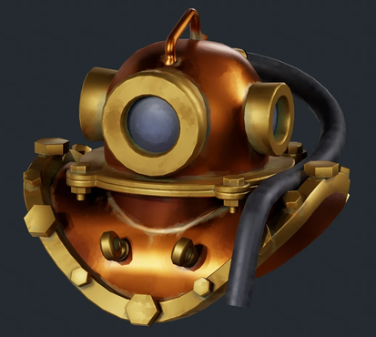
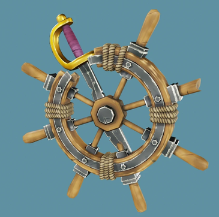
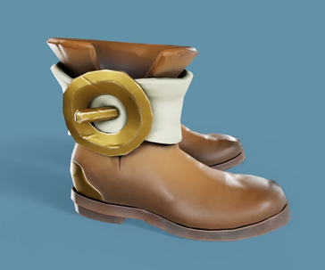
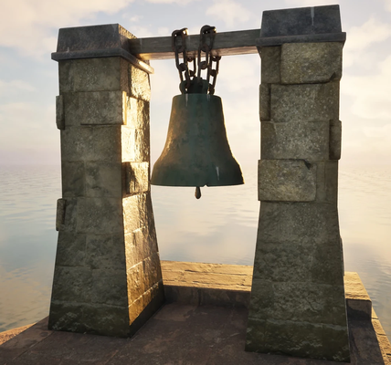
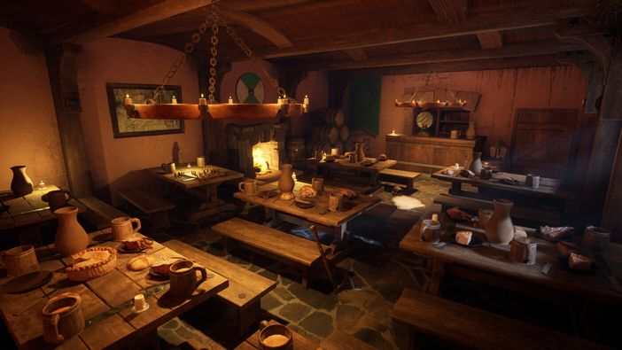

+++
author = "elkrot"
title = "Portfolio: Yehor Kolodiazhnyi"
date = "2026-12-11"
description = "Portfolio: Єгора Колодяжного"
category = "Blender & 3D"
tags = ["3D", "Blender","Ehor"]
draft = false
image = "yehor-pirate-s-trophy.webp"
+++
 
An overview of artwork and 3D projects by 3D artist Yehor Kolodiazhnyi, featured on ArtStation.<!--more-->

## About the Artist & Portfolio

Yehor Kolodiazhnyi is a 3D artist specializing in three-dimensional modeling, visualization, and scene composition in **Blender**. His portfolio demonstrates a high level of detail, strong attention to texturing, and quality work with lighting and rendering.

You can explore the full gallery of his artwork directly on his ArtStation profile:

🔗 [**ArtStation Portfolio — Yehor Kolodiazhnyi**](https://www.artstation.com/user-6668427)

## Gallery of Works

Here are selected examples from the artist's portfolio—ranging from detailed props to complex 3D environments:

*Pirate's Trophy — prop modeling and texturing*

*High-detail boots model*

*3D Bell prop render*

*Atmospheric Tavern environment*

## Key Specializations

* **Hard Surface & Prop Modeling** — Crafting detailed object models, environmental assets, and technical elements with clean topology and efficient UV unwrapping.

* **Environment Design & Scene Setup** — Building atmospheric 3D spaces, configuring natural and artificial lighting, and framing composition.

* **Texturing & Materials** — Working with PBR materials, procedural shaders, and detailed surface texturing to achieve realistic finishes (scratches, wear, micro-relief).

## Tools & Tech Stack

| Domain | Tools |
| ------ | ----- |
| **3D Modeling & Rendering** | Blender (Cycles, EEVEE), Marmoset Toolbag |
| **Texturing** | Substance 3D Painter, Blender Nodes |
| **Post-Processing & Compositing** | Photoshop, Blender Compositor |

## Contact & Collaboration

If you are looking for a 3D artist for game development, visualization, or freelance projects, feel free to review the full portfolio and reach out to the author via ArtStation:

👉 [**Visit ArtStation Portfolio**](https://www.artstation.com/user-6668427)
