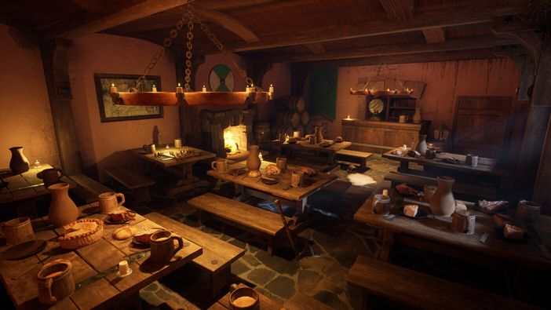
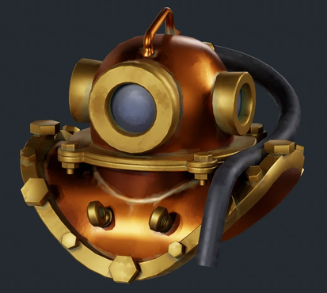
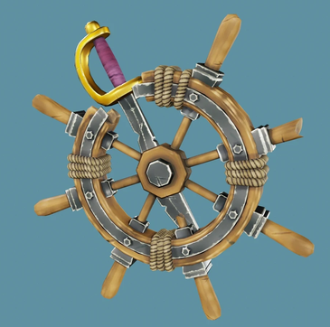
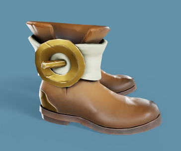
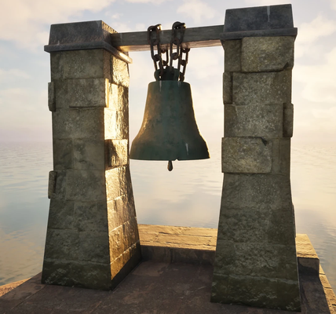

+++
author = "elkrot"
title: "Portfolio: Yehor Kolodiazhnyi"
date = 2026-12-11
category = "Blender & 3D"
tags = ["3D", "Blender","Ehor"]
draft = false
image = "yehor-pirate-s-trophy.webp"
+++

Огляд творчого доробку та 3D-проєктів 3D-художника Єгора Колодяжного (Yehor Kolodiazhnyi), презентованих на платформі ArtStation.

## Про автора та портфоліо

Єгор Колодяжний — 3D-художник, який спеціалізується на тривимірному моделюванні, візуалізації та роботі з 3D-сценами у **Blender**. Його портфоліо демонструє високий рівень деталізації, увагу до текстурування та якісну роботу зі світлом і композицією.

Переглянути повну галерею робіт автора можна безпосередньо на його профілі ArtStation:

🔗 [**ArtStation Portfolio — Yehor Kolodiazhnyi**](https://www.artstation.com/user-6668427)

## Галерея робіт

Нижче представлені приклади робіт із портфоліо автора — від деталізованих пропсів до складних 3D-сцен:

## Основні напрямки та спеціалізація

* **Hard Surface & Prop Modeling** — створення деталізованих моделей об'єктів, предметів оточення та технічних елементів з правильною топологією та UV-розгорткою.
* **Environment Design & Scene Setup** — побудова атмосферних 3D-просторів, налаштування природного та штучного освітлення, робота з композицією кадру.
* **Texturing & Materials** — робота з PBR-матеріалами, процедурними шейдерами та деталізованим текстуруванням для досягнення реалістичного вигляду поверхонь (подряпини, потертості, мікрорельєф).

## Інструменти та техстек

| Сфера | Інструменти |
| ----- | ----- |
| **3D-моделювання та рендеринг** | Blender (Cycles, EEVEE), Marmoset Toolbag |
| **Текстурування** | Substance 3D Painter, Blender Nodes |
| **Пост-обробка та композитинг** | Photoshop, Blender Compositor |

## Контакти та співпраця

Якщо ви шукаєте 3D-художника для ігрових проєктів, візуалізації чи фриланс-завдань, ви можете переглянути повне портфоліо та зв'язатися з автором через його ArtStation:

👉 [**Перейти до портфоліо на ArtStation**](https://www.artstation.com/user-6668427)
