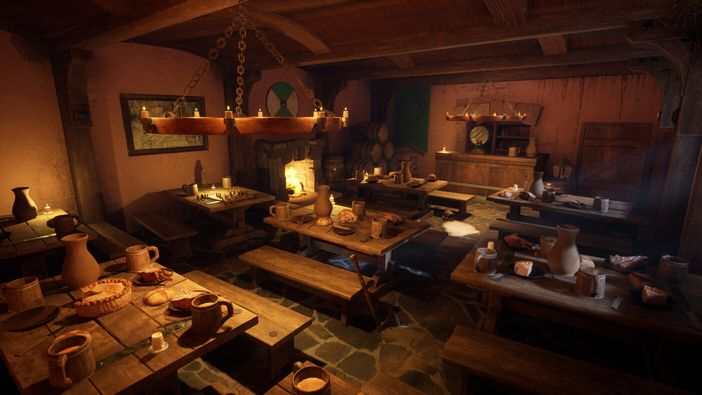
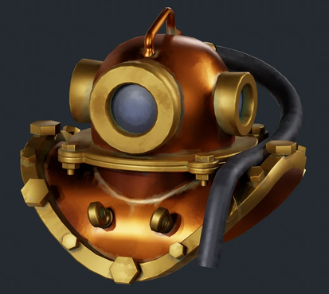
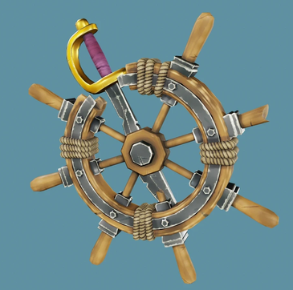
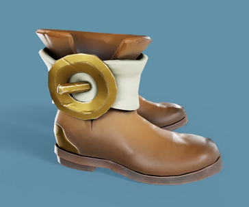
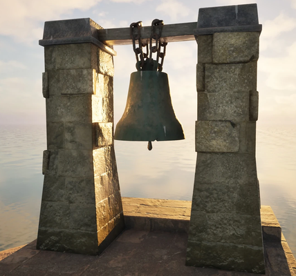

+++
author = "elkrot"
title = "Portfolio: Егора Колодяжного"
date = "2026-11-12"
description = "Portfolio: Егора Колодяжного"
category = "Blender & 3D"
tags = ["3D", "Blender","Ehor"]
draft = false
image = "yehor-pirate-s-trophy.webp"
+++

Обзор творческих работ и 3D-проектов 3D-художника Егора Колодяжного (Yehor Kolodiazhnyi), представленных на платформе ArtStation.<!--more-->

## Об авторе и портфолио

Егор Колодяжный — 3D-художник, специализирующийся на трехмерном моделировании, визуализации и работе с 3D-сценами в **Blender**. Его портфолио демонстрирует высокий уровень детализации, внимание к текстурированию и качественную работу со светом и композицией.

Посмотреть полную галерею работ автора можно непосредственно в его профиле на ArtStation:

🔗 [**ArtStation Portfolio — Yehor Kolodiazhnyi**](https://www.artstation.com/user-6668427)

## Галерея работ

Ниже представлены примеры работ из портфолио автора — от детализированных пропсов до сложных 3D-сцен:

## Основные направления и специализация

- **Hard Surface & Prop Modeling** — создание детализированных моделей объектов, предметов окружения и технических элементов с правильной топологией и UV-разверткой.
- **Environment Design & Scene Setup** — построение атмосферных 3D-пространств, настройка естественного и искусственного освещения, работа с композицией кадра.
- **Texturing & Materials** — работа с PBR-материалами, процедурными шейдерами и детализированным текстурированием для достижения реалистичного вида поверхностей (царапины, потертости, микрорельеф).

## Инструменты и техстек

| Сфера | Инструменты |
| ----- | ----- |
| **3D-моделирование и рендеринг** | Blender (Cycles, EEVEE), Marmoset Toolbag |
| **Текстурирование** | Substance 3D Painter, Blender Nodes |
| **Постобработка и композитинг** | Photoshop, Blender Compositor |

## Контакты и сотрудничество

Если вы ищете 3D-художника для игровых проектов, визуализации или фриланс-задач, вы можете ознакомиться с полным портфолио и связаться с автором через его ArtStation:

👉 [**Перейти к портфолио на ArtStation**](https://www.artstation.com/user-6668427)
